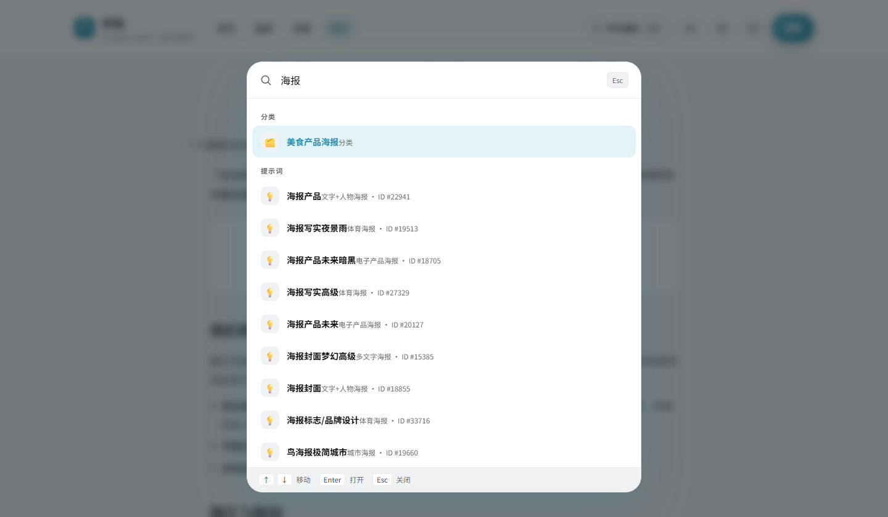
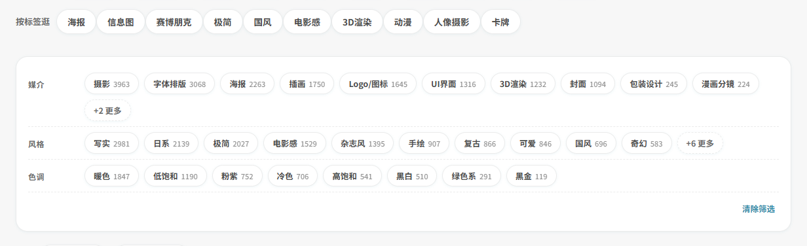
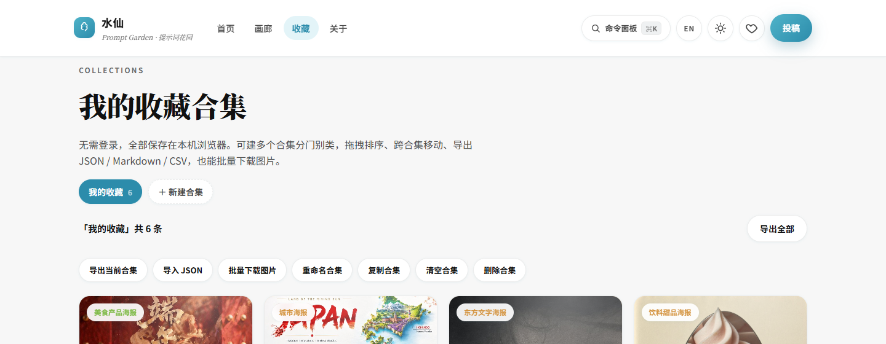
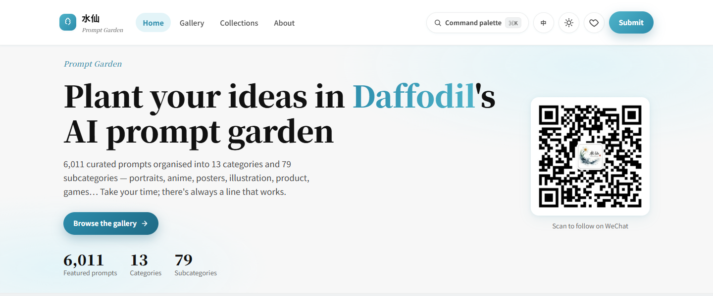
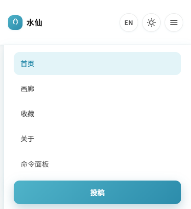

<div align="center">


# 水仙的AI提示词 · Shuixian's AI Prompts

**6,011 curated Chinese AI-art prompts — search, browse, copy in one click. Fully open source.**

13 categories · 79 subcategories · a preview image for every prompt · no login required

[🖥 Live site](https://prompt.qqsrc.com/) ·
[✨ Features](#-features) ·
[🚀 Deploy](#-run-locally--deploy) ·
[🕘 Changelog](https://github.com/BaYue-SYJ/shuixian-prompts/releases) ·
[中文](README.md)

</div>


## What is this

A **Chinese prompt library for AI art**: prompts collected from all over the place, each paired with its generated result, so you can find them, understand them and copy them straight into your tool.

The prompts cover Midjourney, Stable Diffusion, Flux, ChatGPT and Gemini, plus Chinese models such as Jimeng (即梦), Kling (可灵), Doubao (豆包), Hailuo (海螺) and Wenxin Yige (文心一格). The site is **pure static pages**; code and data are fully open source, while the images live in Cloudflare R2 — the repository only holds code and JSON.

**Live site: <https://prompt.qqsrc.com/>**

## ✨ Features

**Find**

- Keyword search: fuzzy matching (`海报设计` also hits 「设计感海报」), with highlight in results
- Pinyin initials: type `sbpk` to get 赛博朋克 (cyberpunk)
- Facet tags: medium (12) / style (16) / tone (8), with live counts and multi-select
- Filters: only-with-image / with-note / favourites / used
- Command palette: `Ctrl / ⌘ + K` searches commands, categories and prompts in one box

**Use**

- One-click copy; `{parameter}` placeholders are left as-is so you can fill them in (the classic skin also has a fill-in form that yields a ready-to-use prompt)
- Image download (filename auto-built from title + ID), `#id=` deep links, context-aware ‹ › paging in the lightbox
- Notes and a “used” counter — saved as you type, kept in your browser only

**Manage**

- Collections: multiple collections, drag-and-drop ordering, move between collections
- Export to Markdown / JSON / CSV (BOM included so Excel opens it cleanly), and re-import your own JSON

**More**

- Two skins: modern (page-per-view) and classic (13-category card wall) — one button in the header switches
- Full bilingual UI: click `EN / 中` to translate the whole site, including all 92 category names (13 categories + 79 subcategories); the choice is remembered
- PWA: installable to desktop, browse the shell and lightweight data offline; press `?` for shortcuts
- Userscript: summon a sidebar to search and copy from ChatGPT / Claude / Gemini / Midjourney / 即梦 pages

## 🚀 Run locally & deploy

Serve it over HTTP — opening the HTML directly will hit `fetch` CORS limits:

```bash
git clone https://github.com/BaYue-SYJ/shuixian-prompts.git
cd shuixian-prompts
python -m http.server 8094 --directory shuixian-unified
```

Open <http://localhost:8094/> and use the button in the header to switch between the modern and classic skins.

**Deploy**: `shuixian-unified/` is a self-contained static folder — drag it into Cloudflare Pages or any static host.
Caching rules live in `_headers`; after changing CSS / JS bump the `?v=` and `ASSET_VERSION` (4 places in total), then purge the cache.

## 🎨 Two skins

Same dataset, two ways to browse. The switch tries to stay on the same kind of page (home↔home, gallery↔gallery, favourites↔favourites).

| Modern — one page per view | Classic — 13-category card wall |
| --- | --- |
|  |  |

<details>
<summary>More screenshots (prompt detail / command palette / facets / collections / English UI / mobile)</summary>

| Prompt detail · copy & save | Command palette ⌘K |
| --- | --- |
|  |  |

| Facet tags | Collections manager |
| --- | --- |
|  |  |

| English UI | Mobile |
| --- | --- |
|  |  |

</details>

## 📁 Project layout

```
shuixian-unified/          The site (self-contained, deployable as-is)
├── index.html  gallery.html  categories.html  detail.html  search.html
├── favorites.html  about.html  sponsor.html  submit.html  404.html
├── classic/               Classic skin (shares the same data/ with the main site)
├── components/  css/      Components and styles for both skins
├── js/
│   ├── base.js            Data loading, cards, lightbox, favourites
│   ├── features.js        Variable filling / facets / search / palette / collections / i18n
│   └── i18n.js            122 UI strings + 92 category names
├── data/                  Dataset (shared by both skins)
├── tools/                 Maintenance scripts (pinyin table, version bump, i18n injection, tests)
├── userscript/            Tampermonkey sidebar script
├── sw.js  manifest.webmanifest   PWA
└── _headers               Cloudflare Pages caching rules
docs/                      Feature notes + screenshots
```

> Older source trees are not kept here — they are archived at
> [Awesome-shuixian-prompts-archive](https://github.com/BaYue-SYJ/Awesome-shuixian-prompts-archive).

## 🗂 Data

Loaded in layers: a lightweight list renders the first screen, the full data is fetched only when you open a detail view or copy a prompt.

| File | Contents |
| --- | --- |
| `data/list.part1~3.json` | Lightweight list (title, category, likes, image path) — first screen |
| `data/prompts.part1~3.json` | Full data including the `prompt` body — loaded on demand |
| `data/meta.json` `data/categories.json` | Category structure (major → subcategory tree / flat map) |
| `data/pinyin.json` | Hanzi → pinyin-initial table used by pinyin search |

Fields: modern skin `id` `title` `prompt` `image` `category` `likes`; classic skin adds `themes` `styles` `person`.

Images are not distributed with the repository: originals live in Cloudflare R2 and the site loads them from
`https://r2.qqsrc.com`. The base URL is the `IMG_BASE` constant in `js/base.js`.

## 🔗 Related projects

| Project | Description |
| --- | --- |
| [shuixian-manju-skills](https://github.com/BaYue-SYJ/shuixian-manju-skills) | A six-piece drama toolkit: from novel to finished short drama |
| [threads-ai-radar](https://github.com/BaYue-SYJ/threads-ai-radar) | Threads viral-content radar, ranked by engagement |
| [zimeiti-workbuddy](https://github.com/BaYue-SYJ/zimeiti-workbuddy) | Creator Buddy: a toolbox for WeChat, Xiaohongshu and short video |
| [web-html-image-skill](https://github.com/BaYue-SYJ/web-html-image-skill) | web-image: render images with HTML/CSS, no image model required |
| [Awesome-shuixian-prompts-archive](https://github.com/BaYue-SYJ/Awesome-shuixian-prompts-archive) | Archived older versions of this project |

## 📄 License

**Attribution licence**: free to study, fork, build upon and repost non-commercially, but please
**keep the credit and link back to this repository**; derivatives must state their source, and commercial use
requires permission from the author first. See [LICENSE](LICENSE) for details.

The prompts and images in this repository were collected and curated from public sources; **copyright belongs to
their respective authors**. This project only organises, categorises and displays them. Please verify the rights
before any commercial use.

## 💬 Contact

- Live site: <https://prompt.qqsrc.com/>
- WeChat Official Account: **水仙的AI提示词** — frequent posts on AI tools and prompts
- WeChat: **Kas2026** — a free community group, no fees; tech-minded folks welcome
- Submissions, fixes and suggestions: open an [Issue](https://github.com/BaYue-SYJ/shuixian-prompts/issues)

| Tip jar | WeChat | Official account |
|:---:|:---:|:---:|
|  |  |  |

## ❤️ Thanks

| Community | Note |
| --- | --- |
| [Linux.Do](https://linux.do) | Share, discuss and follow along with the community — recognised by the LINUX DO community |

---

<div align="center">

[](https://star-history.com/#BaYue-SYJ/shuixian-prompts&Date)

<sub>

**Release notes live in [Releases](https://github.com/BaYue-SYJ/shuixian-prompts/releases)** — this README describes the project itself and is not updated for every version.

If this library helps you, a ⭐ is the best way to say thanks.

</sub>

</div>
